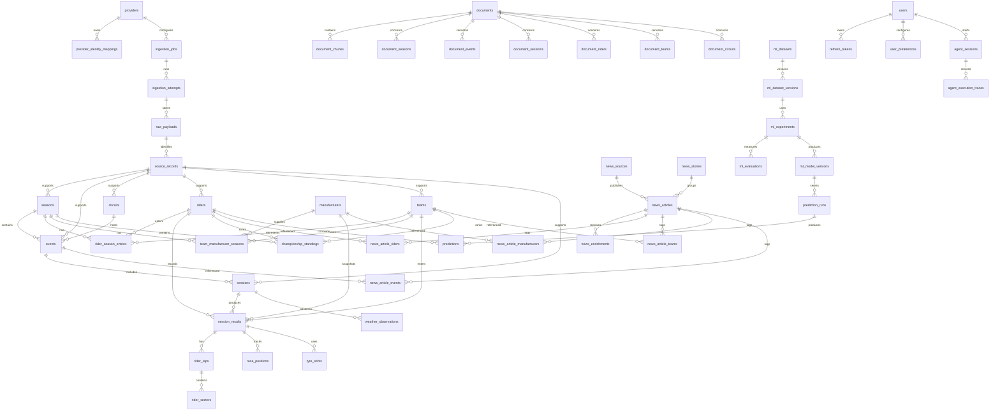

# Implementation-Ready Database Design

Status: Approved baseline; foundational migration V1 implemented.

PostgreSQL is authoritative for normalized structured data. Flyway will own schema changes. The design favors explicit foreign keys and join tables over polymorphic references. JSONB is reserved for provider payloads, variable enrichment, model inputs/outputs, and configuration—not core relationships.

## Revised ER diagram



## Conventions

- Internal primary keys: `uuid`, generated by the application or database.
- External IDs: `text`, scoped by provider and entity type; never used as internal primary keys.
- Times: `timestamptz` stored in UTC. Events and circuits retain an IANA timezone name in `text`.
- Calendar dates without a time: `date`.
- Durations and lap/sector times: integer milliseconds (`integer`); unknown values are `NULL`.
- Counts, positions, laps, and sectors: `smallint` or `integer` with non-negative checks.
- Scores/probabilities: `numeric` with explicit bounds checks, such as `numeric(6,5)` between 0 and 1.
- Missing data is `NULL`, not zero, empty string, or fabricated value. A separate availability/status field is used when “not applicable” differs from “not observed”.
- Provider payloads are retained according to source terms. Store structured JSON in `jsonb`; store non-JSON documents externally with a URI and content hash.
- Every source-backed normalized row has a nullable `primary_source_record_id`. Derived rows identify their input run or source through their owning table.
- All normalized rows have `created_at` and `updated_at`; source observations also have `first_seen_at` and `last_seen_at`.
- Raw payload retention is configurable by provider and legal policy; normalized records and hashes are retained longer than raw content where permitted.

## Table specification

### Provider identity and ingestion

| Table | Important columns and constraints |
|---|---|
| `providers` | `id uuid PK`, `code text UNIQUE`, `name text`, `kind text CHECK`, `enabled boolean`, `terms_url text NULL` |
| `provider_identity_mappings` | `id uuid PK`, `provider_id FK`, `entity_type text CHECK` (`SEASON`, `EVENT`, `CIRCUIT`, `RIDER`, `TEAM`, `MANUFACTURER`, `SESSION`), `provider_external_id text`, `internal_id uuid`, `first_seen_at timestamptz`, `last_seen_at timestamptz`; unique `(provider_id, entity_type, provider_external_id)` and `(provider_id, entity_type, internal_id)` |
| `ingestion_jobs` | `id uuid PK`, `provider_id FK`, `job_type text CHECK`, `schedule text NULL`, `enabled boolean`, `configuration jsonb`, `created_at`, `updated_at` |
| `ingestion_attempts` | `id uuid PK`, `job_id FK`, `started_at`, `finished_at NULL`, `status text CHECK` (`RUNNING`, `SUCCEEDED`, `PARTIAL`, `FAILED`), `records_seen integer CHECK >= 0`, `records_written integer CHECK >= 0`, `error_summary text NULL` |
| `raw_payloads` | `id uuid PK`, `attempt_id FK`, `provider_external_id text NULL`, `payload_format text CHECK`, `payload_json jsonb NULL`, `payload_uri text NULL`, `content_sha256 char(64)`, `content_type text NULL`, `captured_at timestamptz`; check that exactly one of `payload_json` and `payload_uri` is present; unique `(attempt_id, content_sha256)` |
| `source_records` | `id uuid PK`, `provider_id FK`, `raw_payload_id FK NULL`, `entity_type text CHECK`, `provider_external_id text`, `source_version text NULL`, `first_seen_at`, `last_seen_at`; unique `(provider_id, entity_type, provider_external_id)` |

`provider_identity_mappings` is an operational mapping registry. Before implementation, the service must validate that `internal_id` refers to the correct entity table for its `entity_type`; a later refinement may split this registry into per-entity mapping tables if cross-provider reconciliation becomes complex. Core news relationships do not use this pattern.

### Reference and race data

| Table | Important columns and constraints |
|---|---|
| `seasons` | `id uuid PK`, `primary_source_record_id FK NULL`, `year smallint CHECK 1949..2100`, `championship text`, unique `(year, championship)` |
| `circuits` | `id uuid PK`, `primary_source_record_id FK NULL`, `name text`, `country_code char(2) NULL`, `timezone text`, `latitude numeric(8,5) NULL`, `longitude numeric(8,5) NULL`, unique `(name, country_code)` where applicable |
| `events` | `id uuid PK`, `season_id FK`, `circuit_id FK`, `primary_source_record_id FK NULL`, `name text`, `round_number smallint CHECK > 0`, `scheduled_start_at timestamptz NULL`, `timezone text`, unique `(season_id, round_number)`, unique `(season_id, name)` |
| `riders` | `id uuid PK`, `primary_source_record_id FK NULL`, `display_name text`, `given_name text NULL`, `family_name text NULL`, `nationality_code char(2) NULL`, unique normalized display identity as decided by application |
| `manufacturers` | `id uuid PK`, `primary_source_record_id FK NULL`, `name text UNIQUE` |
| `teams` | `id uuid PK`, `primary_source_record_id FK NULL`, `name text`, `country_code char(2) NULL`, unique `(name, country_code)` |
| `team_manufacturer_seasons` | `id uuid PK`, `season_id FK`, `team_id FK`, `manufacturer_id FK`, `valid_from_event_id FK NULL`, `valid_to_event_id FK NULL`, check end is not before start, unique `(season_id, team_id, manufacturer_id, valid_from_event_id)` |
| `rider_season_entries` | `id uuid PK`, `season_id FK`, `rider_id FK`, `team_id FK`, `manufacturer_id FK NULL`, `competition_class text`, `racing_number smallint NULL`, `valid_from_event_id FK NULL`, `valid_to_event_id FK NULL`, checks for positive number and valid range, unique `(season_id, rider_id, valid_from_event_id)` |
| `sessions` | `id uuid PK`, `event_id FK`, `primary_source_record_id FK NULL`, `session_type text CHECK`, `scheduled_start_at timestamptz NULL`, `started_at timestamptz NULL`, `ended_at timestamptz NULL`, `data_mode text CHECK` (`HISTORICAL`, `RECORDED`, `LIVE`), unique `(event_id, session_type)` |
| `session_results` | `id uuid PK`, `session_id FK`, `rider_id FK`, `team_id FK NULL`, `manufacturer_id FK NULL`, `grid_position smallint NULL`, `classification_position smallint NULL`, `classification_status text`, `laps_completed smallint NULL`, `total_time_ms integer NULL`, `points numeric(6,2) NULL`, `primary_source_record_id FK NULL`, unique `(session_id, rider_id)` |
| `rider_laps` | `id uuid PK`, `session_result_id FK`, `lap_number smallint CHECK > 0`, `lap_time_ms integer NULL CHECK > 0`, `is_valid boolean`, `observed_at timestamptz NULL`, unique `(session_result_id, lap_number)` |
| `rider_sectors` | `id uuid PK`, `rider_lap_id FK`, `sector_number smallint CHECK 1..4`, `sector_time_ms integer NULL CHECK > 0`, unique `(rider_lap_id, sector_number)` |
| `race_positions` | `id uuid PK`, `session_result_id FK`, `lap_number smallint CHECK >= 0`, `position smallint NULL CHECK > 0`, `observed_at timestamptz`, unique `(session_result_id, lap_number)` |
| `tyre_stints` | `id uuid PK`, `session_result_id FK`, `start_lap smallint CHECK > 0`, `end_lap smallint NULL`, `compound text NULL`, `tyre_specification text NULL`, check end is not before start, unique `(session_result_id, start_lap)` |
| `weather_observations` | `id uuid PK`, `session_id FK`, `observed_at timestamptz`, `air_temperature_c numeric(5,2) NULL`, `track_temperature_c numeric(5,2) NULL`, `humidity_percent numeric(5,2) NULL CHECK 0..100`, `rain_state text NULL`, `wind_speed_mps numeric(6,2) NULL`, unique `(session_id, observed_at)` |
| `championship_standings` | `id uuid PK`, `season_id FK`, `rider_id FK NULL`, `team_id FK NULL`, `standing_type text CHECK` (`RIDER`, `TEAM`, `MANUFACTURER`), `round_number smallint CHECK >= 0`, `position smallint CHECK > 0`, `points numeric(8,2)`, unique `(season_id, standing_type, rider_id, team_id, round_number)` with the applicable subject non-null |

`session_results` stores the team/manufacturer snapshot actually associated with that session. Season-entry tables preserve historical affiliation and mid-season changes; current team names must never be inferred from a rider profile.

### News and documents

| Table | Important columns and constraints |
|---|---|
| `news_sources` | `id uuid PK`, `provider_id FK NULL`, `name text`, `source_type text CHECK`, `base_url text`, `enabled boolean`, unique `name` |
| `news_stories` | `id uuid PK`, `title text`, `importance_score numeric(5,2) NULL CHECK 0..100`, `created_at`, `updated_at` |
| `news_articles` | `id uuid PK`, `story_id FK`, `source_id FK`, `canonical_url text UNIQUE`, `title text`, `published_at timestamptz NULL`, `fetched_at timestamptz`, `content_hash char(64) NULL`, `summary text NULL`, `verification_status text CHECK`, `primary_source_record_id FK NULL` |
| `news_enrichments` | `id uuid PK`, `article_id FK`, `model_version text NULL`, `category text CHECK`, `importance_score numeric(5,2) NULL CHECK 0..100`, `summary text NULL`, `enriched_at timestamptz`, unique `(article_id, model_version)` |
| `news_article_riders` | `article_id FK`, `rider_id FK`, `association_type text`, PK `(article_id, rider_id, association_type)` |
| `news_article_teams` | `article_id FK`, `team_id FK`, `association_type text`, PK `(article_id, team_id, association_type)` |
| `news_article_manufacturers` | `article_id FK`, `manufacturer_id FK`, `association_type text`, PK `(article_id, manufacturer_id, association_type)` |
| `news_article_events` | `article_id FK`, `event_id FK`, `association_type text`, PK `(article_id, event_id, association_type)` |
| `documents` | `id uuid PK`, `source_name text`, `document_type text`, `canonical_uri text`, `content_hash char(64)`, `version text`, `published_at timestamptz NULL`, `retrieved_at timestamptz`, unique `(canonical_uri, content_hash)` |
| `document_chunks` | `id uuid PK`, `document_id FK`, `chunk_index integer CHECK >= 0`, `text_content text`, `page_number integer NULL CHECK > 0`, `embedding vector` added when embedding dimension is fixed, unique `(document_id, chunk_index)` |
| `document_seasons`, `document_events`, `document_sessions`, `document_riders`, `document_teams`, `document_circuits` | Explicit many-to-many joins with composite primary keys and foreign keys to `documents` and the named domain table |

The previous generic `news_entities(article_id, entity_type, entity_id)` design is removed. Explicit associations are enforceable, queryable, and safe for Java/Spring Data repositories. Document relationships use the same explicit join-table pattern because one document may cover multiple riders, events, or sessions.

### ML lifecycle

| Table | Important columns and constraints |
|---|---|
| `ml_datasets` | `id uuid PK`, `name text UNIQUE`, `task_type text`, `description text` |
| `ml_dataset_versions` | `id uuid PK`, `dataset_id FK`, `version text`, `data_cutoff_at timestamptz`, `source_query_hash char(64)`, `row_count integer CHECK >= 0`, `artifact_uri text`, unique `(dataset_id, version)` |
| `ml_experiments` | `id uuid PK`, `dataset_version_id FK`, `name text`, `algorithm text`, `parameters jsonb`, `started_at`, `finished_at NULL`, `status text CHECK`, unique `(dataset_version_id, name)` |
| `ml_evaluations` | `id uuid PK`, `experiment_id FK`, `split_type text CHECK` (`TIME`, `HOLDOUT`, `CROSS_VALIDATION`), `metrics jsonb`, `evaluation_artifact_uri text NULL`, `created_at` |
| `ml_model_versions` | `id uuid PK`, `experiment_id FK`, `model_name text`, `version text`, `artifact_uri text`, `feature_schema_version text`, `status text CHECK` (`CANDIDATE`, `ACTIVE`, `RETIRED`), `created_at`, unique `(model_name, version)` |
| `prediction_runs` | `id uuid PK`, `model_version_id FK`, `request_id uuid`, `feature_cutoff_at timestamptz NULL`, `input_snapshot jsonb`, `created_at`, `status text CHECK` |
| `predictions` | `id uuid PK`, `prediction_run_id FK`, `rider_id FK NULL`, `session_id FK NULL`, `prediction_type text`, `result jsonb`, `interval jsonb NULL`, `created_at`; check at least one target context is present |

The initial implementation should not create feature-store tables, feature snapshots, online feature tables, drift tables, or model-serving infrastructure tables. Those are future additions after real feature pipelines and evaluation requirements are demonstrated. Model input/output JSONB is acceptable because prediction shapes differ by task; stable fields required for querying should be promoted to columns later.

### Identity and AI audit

The existing identity and agent tables remain as previously documented. They are not required for the first historical-data migration and should be introduced when authentication and AI chat are implemented.

## Important indexes

- `provider_identity_mappings(provider_id, entity_type, provider_external_id)`: resolve provider records idempotently.
- `ingestion_attempts(job_id, started_at DESC)`: operational history and latest attempt.
- `raw_payloads(content_sha256)`: deduplication.
- `source_records(provider_id, entity_type, provider_external_id)`: provenance lookup.
- `events(season_id, round_number)`, `sessions(event_id, session_type)`: schedule navigation.
- `session_results(session_id, classification_position)`: classification views.
- `rider_laps(session_result_id, lap_number)`, `race_positions(session_result_id, lap_number)`: replay and lap analytics.
- `weather_observations(session_id, observed_at)`: time-aligned feature retrieval.
- `championship_standings(season_id, standing_type, round_number, position)`: standings queries.
- `news_articles(published_at DESC)`, `news_articles(source_id, published_at DESC)`: news feeds.
- Association-table indexes on the reverse foreign-key columns, such as `news_article_riders(rider_id, article_id)`.
- `document_chunks(document_id, chunk_index)`: document reconstruction; full-text index on permitted text.
- Vector index on `document_chunks.embedding` only after embedding dimension and distance metric are fixed.
- `ml_model_versions(model_name, status)`, `prediction_runs(model_version_id, created_at DESC)`: model selection and history.

## Ingestion and provenance flow

```text
provider adapter
  -> ingestion_job
  -> ingestion_attempt
  -> raw_payload (hash, format, retention metadata)
  -> source_record (provider/entity/external ID)
  -> identity mapping / reconciliation
  -> normalized row with primary_source_record_id
  -> validation and metrics
```

Ingestion is idempotent by provider/entity/external ID and content hash. Failed attempts and raw payload references are retained according to source terms. A normalized record may be updated when a provider corrects data; the source record and timestamps remain available for audit. Derived analytics, predictions, and enrichments point to their run/model/document inputs rather than pretending to be source facts.

## Migration plan

### Migration 1: foundation and historical reference data

Minimum tables:

- PostgreSQL/pgvector extension decision and common timestamp conventions.
- `providers`, `provider_identity_mappings`, `ingestion_jobs`, `ingestion_attempts`, `raw_payloads`, `source_records`.
- `seasons`, `circuits`, `events`, `riders`, `manufacturers`, `teams`, `sessions`.
- `team_manufacturer_seasons`, `rider_season_entries`.
- Required constraints, foreign keys, and operational indexes.

### Migration 2: race records

- `session_results`
- `rider_laps`
- `rider_sectors`
- `race_positions`
- `tyre_stints`
- `weather_observations`
- `championship_standings`

### Migration 3: news

- `news_sources`, `news_stories`, `news_articles`, `news_enrichments`
- Explicit news article association tables

### Migration 4: documents and RAG

- `documents`, `document_chunks`
- Explicit document-domain association tables
- Embedding index after model dimension is selected

### Migration 5: ML lifecycle

- Dataset, experiment, evaluation, model-version, prediction-run, and prediction tables
- No feature-store tables initially

### Later migrations

Identity, agent traces, simulation-specific persistence, live snapshots, audit events, and operational retention tooling should be added when their owning modules are implemented. They are intentionally not prerequisites for historical race exploration.

## Unresolved decisions and risks

- Confirm the exact provider set, licensing terms, and retention rights before enabling raw payload capture.
- Confirm whether provider identity mappings remain one controlled registry or become per-entity mapping tables after the first two adapters.
- Confirm the embedding model and vector dimension before creating the vector index.
- Confirm whether team/manufacturer affiliation needs event-level precision beyond `valid_from_event_id` and `valid_to_event_id`.
- Confirm the canonical points rules for historical championship seasons before enforcing standings calculations.
- Confirm retention periods for raw article text and provider payloads.
- Historical lap, sector, tyre, and weather coverage may be sparse; nullable fields and explicit availability states are required.
